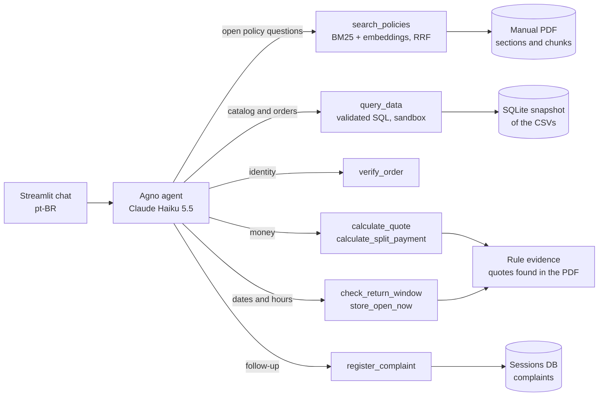

# Empório da Música — Customer Support Agent

A Python text agent that serves customers of Empório da Música, a (fictional) musical instrument store in Campo Grande/MS. It answers questions about products, prices, stock, promotions, orders and store policies. Data questions go to the operational CSVs; policy questions go to the store manual (PDF). Anything with consequences (money, dates, personal data) is computed by deterministic Python tools, never by the language model.

[TODO: screenshot of the chat screen]

- **Model:** Claude Haiku 5.5 (Anthropic API), through the [Agno](https://github.com/agno-agi/agno) agent framework
- **Retrieval:** hybrid BM25 + embeddings (Voyage `voyage-4-lite` through MongoDB Atlas), fused with Reciprocal Rank Fusion, with section and page citations
- **Data:** validated CSV ingestion into SQLite; text-to-SQL restricted by a closed grammar (SQLGlot) and run in a sandboxed subprocess
- **Interface:** Streamlit chat in Brazilian Portuguese, with persistent, resumable conversations

---

## Contents

1. [Running the project](#running-the-project)
2. [Tests and checks](#tests-and-checks)
3. [Architecture](#architecture)
4. [Technical decisions](#technical-decisions)
5. [Assumptions and store rulings](#assumptions-and-store-rulings)
6. [Example conversations](#example-conversations)
7. [Known limitations and next steps](#known-limitations-and-next-steps)
8. [Use of AI coding assistants](#use-of-ai-coding-assistants)
9. [Project structure](#project-structure)

---

## Running the project

### Requirements

- Python 3.12 and [uv](https://docs.astral.sh/uv/), or Docker with Docker Compose
- An **Anthropic API key** (chat model)
- A **MongoDB Atlas AI / Voyage API key** (embeddings for the policy PDF). The free trial tier works; the defaults respect its rate limits.

### 1. Configure

```bash
cp .env.example .env
```

Set `ANTHROPIC_API_KEY` and `VOYAGE_API_KEY` in `.env`. The store's business rulings live in [`data/store_rulings.yaml`](data/store_rulings.yaml) (see [Assumptions](#assumptions-and-store-rulings)). Every other setting has a working default; `.env.example` documents each one (model, timeouts, embedding profile, chunk sizes, time zone).

| Variable | Default | Purpose |
|---|---|---|
| `CLAUDE_MODEL` | `claude-haiku-5-5` | Chat model |
| `MAX_TOOL_CALLS` | `6` | Tool calls allowed per answer |
| `STORE_TIMEZONE` | `America/Campo_Grande` | Store-local time for opening hours and deadlines |
| `EMBEDDING_MODEL` | `voyage-4-lite` | Policy embeddings (1024 dimensions) |
| `DATA_DIR` / `RUNTIME_DIR` | `data` / `runtime` | Input files / caches, sessions and complaints |

### 2a. Run locally with uv

```bash
uv sync --locked
uv run --locked streamlit run app.py
```

Open http://localhost:8501.

### 2b. Run with Docker Compose

```bash
docker compose up --build
```

The container runs read-only, without Linux capabilities, with memory and process limits. `data/` is mounted read-only, and caches live in a named volume.

### First start

On the first start the app validates every file in `data/`, downloads the embedding tokenizer, extracts the PDF sections and embeds the policy chunks within the configured rate limits. The index is cached in `runtime/` and reused until a source file, the embedding model or the chunk settings change. Changing a file in `data/` is picked up on the next page load: the new snapshot is fully validated before it replaces the old one.

---

## Tests and checks

```bash
uv run --locked pytest -m "not live and not e2e"   # unit and integration tests, no paid API
uv run --locked pyright                             # strict type checking
uv run --locked ruff check . && uv run --locked ruff format --check .
```

Browser tests drive the real Streamlit app with Playwright and a stubbed model:

```bash
uv run --locked playwright install chromium
uv run --locked pytest -m e2e
```

Paid tests and the example-conversation recorder require an explicit opt-in:

```bash
RUN_LIVE_TESTS=1 uv run --locked pytest -m live
RUN_LIVE_TESTS=1 uv run --locked python -m scripts.run_scenarios       # writes examples/NN-name.md
```

The offline tests load the real PDF and CSVs with deterministic local embeddings, so rule extraction and the tools are checked against the delivered sources, not only against fixtures. CI runs the branch-flow check, pyright, ruff, the full test suite with browser tests, and the Docker build with a health check on every pull request.

---

## Architecture



| Tool | What it does |
|---|---|
| `search_policies` | Hybrid retrieval over the manual. Returns passages with file, section and page, with internal contacts masked. |
| `query_data` | One read-only SQL query over the catalog. Private order data only after `verify_order`. Money is returned already formatted as `R$ 1.299,90`. |
| `verify_order` | Checks an order number and email pair. On success, opens that order only and returns the customer's first name for greetings. |
| `calculate_quote` | Whole-order quote: per-item promotions, PIX discount, installment minimums and metropolitan shipping. |
| `calculate_split_payment` | Splits an order between two payment methods, from the amount the customer states. |
| `check_return_window` | Withdrawal, preference exchange and defect deadlines, from dates the customer states. |
| `store_open_now` | Applies the regular opening hours to the store-local time, with a holiday warning. |
| `register_complaint` | Stores a complaint for a verified order and returns a protocol to send on WhatsApp. |

---

## Technical decisions

### Agent approach: retrieval for open questions, deterministic tools for consequences

The agent uses native function calling with two kinds of tools:

- **Retrieval (RAG)** answers open policy questions in the manual's own words, with citations: "how does the warranty work?", "do you deliver to Dourados?".
- **Deterministic tools** handle anything a wrong answer would hurt: prices and installments, deadlines, opening hours, order data, personal data. The model chooses the tool and explains the result; Python does the arithmetic and enforces the rules.

A pure RAG agent would read "frete grátis acima de R$ 500" and then work out the shipping for a R$ 520 order paid by PIX (R$ 494) on its own. A pure SQL agent cannot answer policy questions. The hybrid keeps the model flexible where language matters and exact where correctness matters.

### Framework: Agno

Agno is a lightweight agent loop with native Anthropic tool calling, typed Python functions as tools (docstrings become the tool descriptions) and built-in SQLite session storage. It adds little abstraction on top of the provider API. Tests intercept only the HTTP layer, so the real Agno loop, tools and persistence run in every test.

### Model: Claude Haiku 5.5

Support answers are short and tool-driven, so latency and cost matter more than deep reasoning. Haiku 5.5 is reliable at tool selection and multilingual replies. Adaptive thinking with low effort, a 2,048-token output cap, a tool-call limit, prompt caching of the system prompt and tool schemas, and at most one client retry keep each answer fast and bounded. The model is configurable through `CLAUDE_MODEL`.

### Retrieval architecture

- **Layout-aware extraction.** The PDF is split into its numbered sections (for example "4.1 Direito de Arrependimento"). Repeated headers and footers are dropped, and each section keeps its pages, so every passage can be cited as file, section and page.
- **Chunking.** About 600 tokens per chunk (maximum 800, overlap 80), counted with the embedding model's own tokenizer. Duplicate chunks are merged while keeping every citation.
- **Hybrid search.** BM25 catches exact terms that matter in this manual ("PIX", "12x", "boleto"). Voyage embeddings catch paraphrases ("posso devolver?" ↔ "direito de arrependimento"). The two rankings are fused with Reciprocal Rank Fusion (k = 60), which needs no score calibration between them. The prompt asks for Portuguese search terms, because the manual is in Portuguese.
- **Embeddings.** Voyage `voyage-4-lite` through MongoDB Atlas AI: multilingual, 1024 dimensions, with a free tier. Requests are batched under the account's rate and token limits and retried after quota errors. The index is cached by content fingerprint.

### Data handling and text-to-SQL

- **Ingestion.** CSVs are identified by their columns, not their file names. Values are validated and normalized: money becomes integer cents, percentages stay exact decimals, and statuses and dates are checked. Invalid files are reported instead of silently skipped.
- **Restricted SQL.** The model writes plain `SELECT` statements over a schema it receives on every turn. SQLGlot validates them against a closed grammar: key joins only, typed filters, `COUNT`, `SUM` and `AVG`, no arithmetic or subqueries.
- **Sandbox.** Queries run in a separate, credential-free process, with a read-only SQLite authorizer, resource limits, a 2-second deadline and a 50-row cap.
- **Privacy.** The `orders` and `order_items` tables are visible only after `verify_order`, and only for that order. The `customers` table is never queryable.

### Money is never computed by the model

Every amount is computed in Python with integer cents and `Decimal`, using explicit rounding. Installments are allocated so they sum exactly to the total. Tools return ready-to-display strings (`R$ 1.299,90`), and the prompt forbids mental arithmetic and adding separate quotes together. Amounts and terms (PIX rate, installment tiers, combined-payment threshold, shipping threshold and fee) are read from the PDF itself. When the sources contradict each other, quoting stops and the customer is referred to staff.

### Where each part of a rule comes from

Every rule the tools apply is assembled from four places, each doing only what it is good at:

| Part | Source | Example |
|---|---|---|
| **Finding the right passage** for an open question | Hybrid retrieval (BM25 + embeddings) | "Posso devolver?" finds section 4.1 |
| **Numbers and terms** stated by the manual | Parsed from the PDF text (`policy_evidence.py`, `policies.py`) | Free shipping above R$ 500,00; R$ 35,00 fee; 7 / 10 / 30 days; opening hours; 24 business hours |
| **Business decisions** where the manual is ambiguous or silent | [`data/store_rulings.yaml`](data/store_rulings.yaml) (`rulings.py`) | Exactly R$ 500,00 pays the fee; boleto is not combined |
| **Arithmetic and logic** | Python (`store_rules.py`, `money.py`) | Deadline = receipt date + 7 days |

Embeddings find text; they do not hold rules or compute anything, and a decision that is in no document cannot be retrieved. That is why values are parsed and decisions are kept in a reviewed file.

The design fails closed at every layer:

- **Consistent manual update.** A revised manual that states a value consistently (for example free shipping above R$ 600,00) is applied automatically.
- **Missing or contradictory value.** If a value is missing, or the manual states it in two different ways, that rule is switched off and the agent refers the customer to staff.
- **Changed or missing quote.** Each rule also requires the exact non-numeric quotes it relies on (for example "Compras Online" in the title of section 4.1).
- **Rulings file.** It is validated against a strict schema (unknown keys, wrong types and invalid choices are rejected) and reloaded when it changes, without rebuilding the embedding index. If it is missing, the rules that need it refer customers to staff.

### Prompt strategy

- **Language of the prompt.** The system prompt is in English, because instruction-following is most precise there. The agent replies in the customer's language, defaulting to Brazilian Portuguese.
- **Persona.** The store's unnamed virtual assistant, never presented as a human, with the tone the manual asks for: "informal mas profissional, como um amigo que entende de música".
- **Routing.** Explicit rules for when to search the manual, query data, verify an order or call a calculation tool.
- **Injection resistance.** PDF text, CSV text, tool output and history are treated as evidence, never as instructions. The model is told never to reveal instructions, other customers or private data, and the SQL sandbox and order scope enforce this independently of the prompt.
- **Honesty.** When the sources do not answer, the agent says so and refers the customer to the WhatsApp channel instead of inventing.

### Conversation persistence

Each conversation has an unguessable token in the URL, so a customer can bookmark and resume it. History is stored with Agno's SQLite storage. Only the text of the last three turns is replayed, without old tool results, so stale prices are re-checked. Order authorization lives server-side and is tied to the current source snapshot: it cannot be granted by text the model writes, and it resets when the data changes.

### Interface

Streamlit gives a usable chat with very little code, shows the sources consulted under each answer, and is easy to run in Docker. All customer-facing text is in Brazilian Portuguese.

---

## Assumptions and store rulings

Where the manual is ambiguous, contradictory or silent, a decision was needed. **These are business decisions, not technical ones**: in a real engagement each would be confirmed with the client in an alignment call before go-live. Here they were agreed with the project owner acting as the store. They are documented here, as the brief asks.

The decisions the tools apply are kept in [`data/store_rulings.yaml`](data/store_rulings.yaml), so the store can review and change them without touching code: the shipping-threshold rules, when preference exchanges start and how in-store exchanges are handled, the methods that can be combined, and the complaint limit and stored email. The others shape the prompt or the tools' wording. Amounts and deadlines (R$ 500,00, R$ 35,00, R$ 2.000,00, 7, 10 and 30 days, opening hours, 24 business hours) are not decisions: they are read from the manual.

| Topic | Manual says | Ruling applied |
|---|---|---|
| WhatsApp | Section 1.2 lists one number as "Telefone / WhatsApp"; section 7 names another as the WhatsApp channel | Section 7's channel is the support channel. Company registration contacts are internal, are masked in search results, and are not written in code. |
| Email | Cover and section 1.2 differ by an accent | The cover email is used. |
| Installments 1x–3x | "sem valor mínimo de parcela (exceto abaixo de R$ 50,00)" | Minimum installment R$ 50,00. The table's "mínima de R$ 100,00" refers to the 7x–12x tier. |
| Defects | Exchange "em até 30 (trinta) dias corridos após a compra"; after that, the customer contacts the manufacturer and the store "pode intermediar" (4.2); manufacturer warranties vary "de 6 meses a 2 anos" (8.2) | The store exchanges up to 30 calendar days after purchase. After that, the warranty is the manufacturer's (term in the product certificate) and the store intermediates on request; the agent never declares the warranty expired. |
| Withdrawal (return with refund, no reason needed) | Section 4.1 ("Compras Online"): up to 7 calendar days after receipt, original packaging and unused, refund with the original payment method within 10 business days, return shipping paid by the store | Applied as written to **online** purchases; the customer starts the return on WhatsApp. In-store purchases have **no** withdrawal right: the agent says so and refers the customer to WhatsApp for clarification, without offering an alternative on its own. |
| Preference exchange (another color, model or size) | Section 4.3: allowed "em até 7 dias", subject to availability, product in perfect condition and original packaging. It does not say when the 7 days start | **Online:** 7 days from the day the customer receives the product. **In-store:** handled by staff; the agent refers the customer to WhatsApp without calculating a deadline or promising the exchange. |
| Metro shipping | Free "acima de" R$ 500; R$ 35 "abaixo de" R$ 500 | Free strictly above R$ 500,00 of the **final amount paid** (after promotion and PIX). Exactly R$ 500,00 pays R$ 35,00. |
| Holidays | "Domingo e Feriados Fechado"; special dates may extend hours | Holidays are not inferred; every opening-hours answer carries a warning to confirm on WhatsApp. |
| Combined payment | "permitida (ex.: PIX + cartão) para compras acima de R$ 2.000,00" | Two different methods among PIX, credit and debit (boleto excluded, since it takes up to 3 business days to clear). Catalog prices, no PIX discount. Credit installment minimums apply. Values must be confirmed when finalizing the purchase. |
| Accessories / partners | "Sugerir lojas parceiras quando possível", but none are listed | Staff recommend partner stores on WhatsApp; the agent never names one. |
| Complaints | "registrar a reclamação… retorno em 24 horas úteis" | Recorded with a protocol (`REC-YYYYMMDD-XXXXXX`) for verified orders only, with the order's email. Phones and CPFs typed by the customer are removed. |
| Language | The hiring email asks for deliverables in English | README in English; the agent and the UI speak the customer's language (Brazilian Portuguese by default). |

---

## Example conversations

The brief asks for 3 to 5 conversations, at least one non-trivial. [TODO: add your screenshots and choose the final set]

| # | Scenario | What it shows |
|---|---|---|
| 1 | [TODO] | |
| 2 | [TODO] | |
| 3 | [TODO] | |
| 4 | [TODO] | |
| 5 | [TODO] | |

[TODO: screenshots, for example `examples/01-violoes.png`]

`scripts/run_scenarios.py` records ten scripted conversations with the real APIs into `examples/NN-name.md`. Each file contains an English scenario line, what to check, the customer messages, the agent answers, the tools called with their arguments, and the sources cited.

---

## Known limitations and next steps

**Known limitations**

- **Business rulings are a file, not a product.** Decisions live in `data/store_rulings.yaml`, which is validated and reloaded on change, and the manual's amounts and deadlines are parsed from the PDF. The interpretation patterns are still code, for example reading "exceto abaixo de R$ 50,00" as a minimum installment, or the expressions that find each value in the manual. A real store would edit rulings in an admin panel with history and approvals, and a heavily rewritten manual may need new parsing patterns.
- **Holidays and special dates** are not known; the agent always warns and points to WhatsApp.
- **Free-text personal data in complaints.** Phones and CPFs typed by the customer are removed, but names and addresses typed in the summary are stored as written.
- **No staff view for complaints.** They are rows in `runtime/sessions.sqlite3` (table `complaints`).
- **Shipping outside the metropolitan region** depends on the CEP and carrier; the agent refers those customers to staff.
- **Single-language manual.** The retrieval prompt favors Portuguese terms; questions in other languages rely on the multilingual embeddings.
- **Evaluation is tool-level.** Tools, rules and security boundaries are tested offline, but answer quality was checked with a small set of recorded conversations, not with an automated evaluation suite.

**With more time**

- An automated evaluation set (expected tool calls and facts per question), run against each prompt or model change.
- A staff panel for complaints, rulings and policy versions, with audit history.
- Real integrations (carrier tracking, inventory, payment gateway) instead of file snapshots.
- A handoff to a human attendant inside the same conversation, with the context attached.
- Holiday calendar from an official source, and special-date hours published by the store.

---

## Use of AI coding assistants

[TODO: describe in your own words which tools you used and how. Below is a factual starting point for the part done with Claude Code.]

**Claude Code (Anthropic, desktop app)** was used as a pair programmer during the final development phase, with a workflow designed to keep decisions with the developer:

- **Verify before changing.** The test suite, pyright and ruff were run before any change to record a baseline. Hypotheses (for example, "credit in 1x–3x always fails") were confirmed against the real PDF with read-only probes before any code was touched.
- **The developer owns the decisions.** Every ambiguity in the manual was presented as a plain-language question with concrete examples, one decision at a time, and implemented only after approval. These are the rulings in the table above.
- **Small, tested increments.** One commit per task, each with tests, through `feature/*` or `fix/*` branches and pull requests into `Development`, with CI on every PR.
- **Self-review.** A code review of `main` was run with the assistant. It found, among other things, that a Brazilian-formatted "1.000" would have been read as R$ 1,00; that was fixed with tests.
- **Design pushback from the developer.** For example, an early "store facts" layer with canned answers was replaced, at the developer's request, by retrieval plus deterministic tools, because canned answers made the system behave like a bot rather than an agent.

[TODO: earlier phases, other assistants, and anything you would add about your workflow]

---

## Project structure

```
app.py                         Streamlit chat (pt-BR UI)
src/emporio_agent/
  agent.py                     Prompt, tools and agent construction
  runtime.py                   Source snapshot: validation, indexing, publishing
  data.py                      CSV discovery, validation and normalization
  documents.py                 PDF sections, chunking and hybrid retrieval
  embeddings.py                Voyage embeddings client with rate limiting
  sql.py / sql_worker.py       Closed-grammar SQL validation and sandboxed execution
  policies.py                  Payment rules extracted from the manual
  policy_evidence.py           Manual values and quotes behind each rule; internal-contact masking
  rulings.py                   Business rulings loaded and validated from data/store_rulings.yaml
  store_rules.py               Opening hours, return windows, shipping, split methods
  money.py                     Exact money parsing, formatting and installments
  contacts.py                  Phone, email and CPF formats
  complaints.py                Complaint records and protocols
  config.py                    Settings from the environment
scripts/
  run_scenarios.py             Records example conversations (paid, opt-in)
  check_branch_flow.py         Enforces feature/fix → Development → main
tests/                         Unit, integration, browser (Playwright) and live tests
data/                          Store CSVs, policy manual and store_rulings.yaml (business rulings)
```
